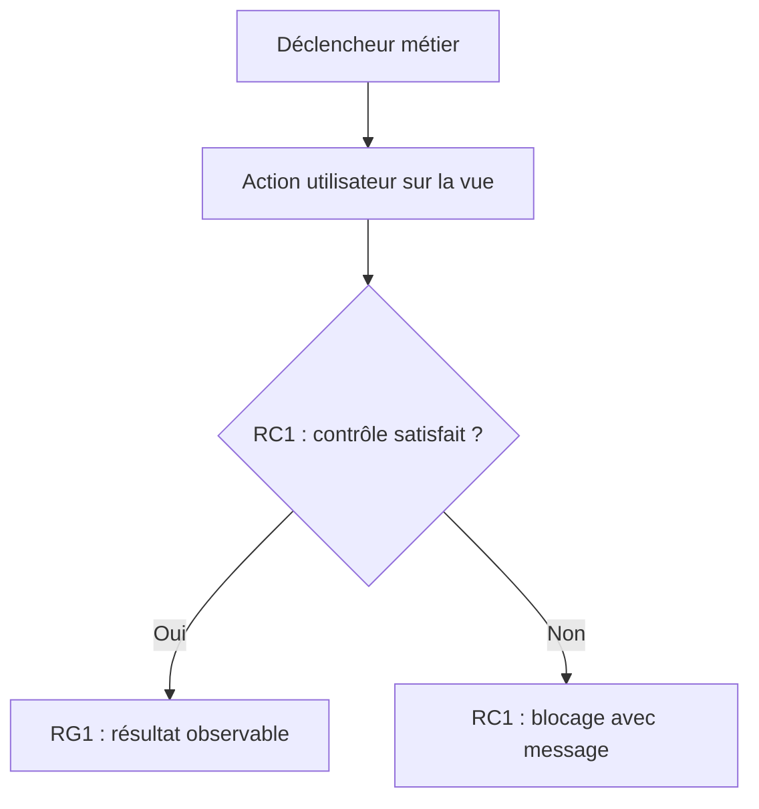

---
# Métadonnées locales de travail (retirées ou conservées selon publication Redmine)
client: [Nom ou slug du client]
titre: [Titre de l'évolution — verbe + objet métier]
etat: brouillon                  # brouillon -> valide -> publie
sources: [notes d'atelier du ..., ticket #..., fichier Drive ...]
relecteur: [Nom du CDP / Solution Architect]
redmine: ~                       # Numéro du ticket Redmine après création
---

# [Titre — verbe + objet, ex. « Automatisation du calcul des frais de transport »]

*Ticket interne — spécification allégée. Rédigée le AAAA-MM-JJ à partir de : [sources].*

## 1. Besoin & objectif métier

[2 à 6 phrases synthétiques : situation actuelle, douleur ou besoin client, résultat métier mesurable attendu. Échéance si connue.]

## 2. Comportement attendu

### Vues et écrans impliqués

| Vue / Écran | Nom technique (si connu) | Rôle dans l'évolution |
| :--- | :--- | :--- |
| [ex: Commande client] | `sale-order-form` | [Créée, étendue, consultée — impact précis] |

### Parcours utilisateur

1. [Rôle de l'acteur] accède à [vue] et déclenche [action / clic / sélection].
2. L'ERP calcule / met à jour [champs impactés].
3. L'utilisateur valide [statut / transition].

### Diagramme du parcours métier

### Règles de gestion (RG)

- **RG1** — [Description précise de la règle, formules de calcul, conditions de déclenchement ; mentionner « Standard AOS » si déjà couvert nativement].
- **RG2** — [Autre règle métier].

### Règles de contrôle (RC)

- **RC1** — Si [condition d'erreur], bloquer la sauvegarde/action avec le message exact : « [Message d'erreur affiché à l'utilisateur] ».

## 3. Scénarios de tests

*Jeu de données commun : [Partenaires, articles, devises ou configurations nécessaires aux tests].*

### S1 — [Titre] (Cas Nominal — Couvre RG1, RG2)
- **Pré-conditions :** [Paramétrages actifs, entités existantes en recette].
- **Données de test :** [Valeurs réelles utilisées : ex. Montant HT = 100€, Taux TVA = 20%].
- **Parcours :** [Actions pas-à-pas dans l'interface].
- **Résultat attendu :** [Résultat exact observable, statut, montants calculés].

### S2 — [Titre] (Cas Limite / Cas Particulier)
- **Pré-conditions :** [Pré-conditions spécifiques].
- **Données de test :** [Valeurs limites : seuil zéro, devise étrangère, etc.].
- **Parcours :** [Actions dans l'interface].
- **Résultat attendu :** [Résultat exact observable].

### S3 — [Titre] (Cas Dégradé / Erreur — Couvre RC1)
- **Pré-conditions :** [Pré-conditions].
- **Données de test :** [Donnée invalide déclenchant le contrôle].
- **Parcours :** [Tentative de validation].
- **Résultat attendu :** [Blocage net, affichage exact du message de RC1, aucune écriture parasite en base].

### Matrice de couverture

| Règle | S1 | S2 | S3 |
| :--- | :---: | :---: | :---: |
| RG1 | × | | |
| RG2 | × | × | |
| RC1 | | | × |

## 4. Volumétries & performances attendues

| Volume traité | Temps d'exécution attendu |
| :--- | :--- |
| [Moins de N enregistrements] | [Instantané / < 2s] |
| [Traitement batch / Import massif] | [< 1 minute] |

## 5. Hors périmètre & questions ouvertes

- **Hors périmètre :** [Ce qui est explicitement exclu du lot].
- **Questions ouvertes :** [Points en suspens nécessitant arbitrage du client ou du dev].
