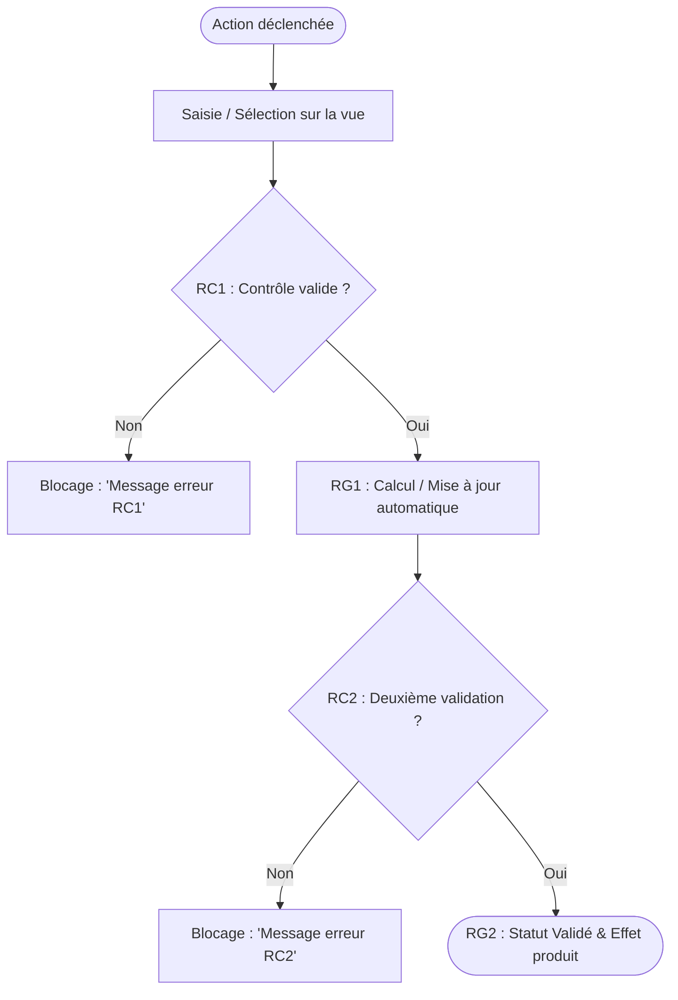

# Règles de Modélisation des Diagrammes Mermaid

Tout ticket de spécification fonctionnelle doit contenir un diagramme Mermaid visualisant le parcours utilisateur et les embranchements de contrôle.

## 1. Principes Directeurs
- **Type de diagramme** : Préférer `flowchart TD` (Top-Down) ou `flowchart LR` (Left-Right) pour la lisibilité sur Redmine / Markdown.
- **Orientation Métier** : Le diagramme modélise les décisions métier et les états visibles, **JAMAIS** les classes Java, tables SQL ou contrôleurs techniques.
- **Liaison explicite aux RG et RC** :
  - Chaque nœud de décision (losange `{}`) doit porter la référence de la règle de contrôle (ex: `RC1`).
  - Chaque nœud de sortie nominale doit porter la règle de gestion associée (ex: `RG1`).
  - Les nœuds d'échec doivent afficher le blocage net et le message d'erreur.

## 2. Gabarit Recommandé



## 3. Invariants de Syntaxe
- Entourer systématiquement les libellés avec des guillemets doubles droits (`"Texte"`) pour éviter les conflits avec la ponctuation ou les caractères spéciaux.
- Garder les libellés courts et percutants (max 6-8 mots par bloc).
- Conserver le bloc clôturé standard ` ```mermaid ... ``` ` sans balises HTML superflues.
