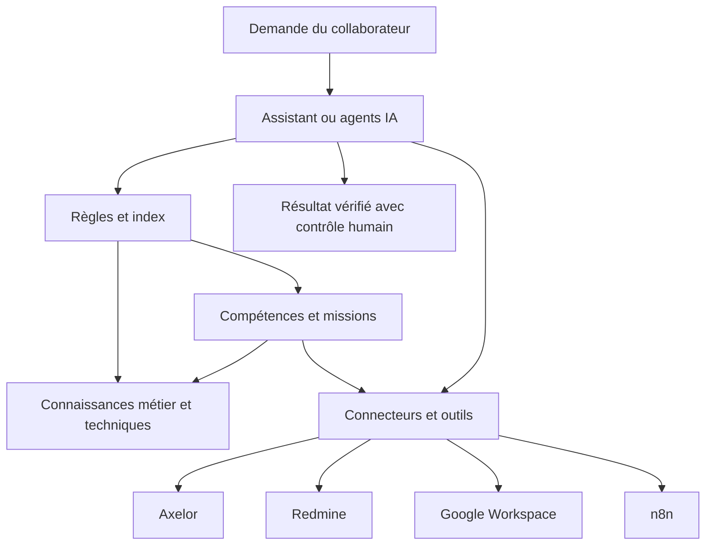

# AgenticAxelor

**Le second cerveau d'Alter-si : un environnement de travail pour les assistants et agents IA.**

AgenticAxelor rassemble des connaissances, des méthodes et des outils pour aider les équipes à comprendre une demande, retrouver les bonnes informations et accomplir leurs missions. Il ne se limite pas à un connecteur Axelor : il fournit aux assistants un contexte de travail organisé et évolutif.

**Les connecteurs sont la clé pour exploiter pleinement cet environnement.** Reliés aux outils d'Alter-si, les assistants peuvent mettre les connaissances au service du travail réel : consulter l'ERP, analyser un ticket, exploiter un document ou accompagner une automatisation. Chaque connexion doit être configurée et reste soumise aux droits et autorisations applicables.

## Comment ça fonctionne

Une demande est prise en charge par un assistant compatible qui s'appuie sur les ressources adaptées à la mission :

1. **Les règles et les index** orientent l'assistant vers le contexte pertinent et les précautions à respecter.
2. **Les connaissances** apportent des repères métier et techniques.
3. **Les compétences et les missions** décrivent des méthodes de travail réutilisables.
4. **Les connecteurs** donnent accès aux informations et aux actions disponibles dans les outils reliés.
5. **L'utilisateur garde le contrôle**, notamment pour les actions nécessitant une autorisation ou une confirmation.

Ces ressources forment un graphe contextuel : elles sont liées entre elles et peuvent être mobilisées en fonction de la tâche. Ce graphe est une organisation de fichiers, de références et de règles, pas une mémoire qui apprend automatiquement. Il peut évoluer avec les besoins, les connaissances et les outils d'Alter-si.



Ce schéma simplifie les relations entre les ressources. Pour explorer leur cartographie détaillée, ouvrez [la carte du contexte](context-graph.html). Les connexions aux outils externes dépendent de leur configuration et des accès disponibles.

Selon l'assistant utilisé et ses capacités, une mission peut être réalisée par un agent ou déléguée à plusieurs agents. La création et l'orchestration de ces agents dépendent de l'environnement qui les exécute.

## Exemples d'utilisation

- **Préparer une spécification** : partir de notes d'atelier, qualifier le besoin, consulter les références Axelor pertinentes et préparer un document structuré pour les développeurs. Les vérifications sur l'instance et la publication éventuelle dépendent des connexions et autorisations disponibles.
- **Comprendre un ticket** : retrouver son contexte, son objectif et les actions attendues, à partir de Redmine lorsque le connecteur est disponible.
- **Explorer Axelor** : rechercher un modèle, comprendre un écran, consulter des données ou préparer un export avec le connecteur Axelor.
- **Suivre une intervention** : préparer un compte rendu et un brouillon de réponse, avec validation avant publication lorsque nécessaire.
- **Analyser une automatisation** : s'appuyer sur les connaissances et les outils n8n disponibles pour comprendre un workflow ou diagnostiquer une exécution.

## Les connecteurs

Sans connecteur, un assistant peut utiliser les ressources locales accessibles dans le projet. Il ne peut pas pour autant consulter les systèmes externes ou y agir. Avec les connecteurs configurés et les accès nécessaires, il peut combiner le contexte du projet avec les informations et outils de travail.

| Outil | Utilité | Disponibilité |
| :--- | :--- | :--- |
| Axelor | Explorer les modèles, écrans et données ; produire des exports et documents ; effectuer les actions autorisées. | Serveur MCP inclus dans ce dépôt. Session navigateur à synchroniser. |
| Redmine | Consulter les tickets et préparer ou effectuer les opérations autorisées. | Connecteur externe à configurer dans l'environnement utilisé. |
| Google Workspace | Consulter ou utiliser les services Google disponibles, selon les besoins et les droits. | Serveur MCP externe à configurer et autoriser. |
| n8n | Consulter les workflows et les exécutions, et accompagner les opérations autorisées. | Outil externe à installer et configurer. |

La présence d'une instruction ou d'un connecteur ne garantit ni l'accès à un service ni le droit d'y modifier des données. Les capacités réellement disponibles dépendent de la configuration et des permissions de chaque utilisateur.

## Sécurité et contrôle

- Les actions dans Axelor utilisent la session et les droits de l'utilisateur connecté. Le fichier local `.session.json` contient des données de session sensibles et ne doit pas être partagé.
- Les accès aux autres services dépendent de leurs propres configurations et permissions.
- Les règles du projet demandent de vérifier les informations nécessaires avant une modification et de contrôler le résultat après l'action.
- Les actions sensibles, destructives ou susceptibles de communiquer à l'extérieur nécessitent les autorisations et confirmations applicables.
- Pour les essais à risque, privilégier un environnement de recette lorsque c'est possible.

## Bien démarrer

### 1. Ouvrir l'environnement de travail

Ouvrez le dossier du projet dans votre assistant compatible. Le fichier [`AGENTS.md`](AGENTS.md) et les ressources du dossier [`.agents`](.agents/) orientent l'assistant vers les règles, connaissances et compétences adaptées à la demande.

Les assistants ne prennent pas tous en charge les mêmes mécanismes de contexte, de compétences ou de délégation. Vérifiez la configuration de celui que vous utilisez.

### 2. Connecter les outils utiles à votre activité

Configurez les connecteurs nécessaires dans votre assistant et vérifiez vos accès. Les connecteurs Redmine, Google Workspace et n8n sont externes au serveur MCP Axelor fourni par ce dépôt. Leur disponibilité dépend de votre poste, de votre client et de vos autorisations.

Pour Axelor, suivez les étapes ci-dessous. L'installation du connecteur Axelor ne configure pas automatiquement les autres services.

### 3. Installer le connecteur Axelor

#### Installation guidée avec Goose

1. Téléchargez et décompressez le projet, puis ouvrez son dossier dans Goose.
2. Demandez dans le chat : « Lance le setup du projet » ou utilisez `/setup-assistant` si cette commande est disponible.
3. Suivez les instructions de l'assistant pour préparer l'environnement et démarrer le Bridge local.
4. Chargez l'extension Chrome depuis le dossier `extension/`, puis synchronisez votre session depuis la page Axelor.

#### Installation manuelle

1. Installez les dépendances et compilez le projet :

   ```bash
   npm install
   npm run build
   ```

2. Déclarez le serveur MCP dans la configuration de votre client, en remplaçant le chemin par celui de votre projet :

   ```json
   {
     "mcpServers": {
       "agentic-axelor": {
         "command": "node",
         "args": ["<CHEMIN_ABSOLU_DU_PROJET>/dist/index.js"]
       }
     }
   }
   ```

3. Démarrez le Bridge local :
   - Windows : exécutez `start-bridge.bat`.
   - macOS ou Linux : exécutez `npm run bridge`.
4. Chargez l'extension Chrome non empaquetée depuis `extension/`. Depuis votre page Axelor, cliquez sur **Synchroniser la session**.
5. L'extension permet d'activer, désactiver ou supprimer les sessions enregistrées. Une session active n'est pas nécessairement encore valide : resynchronisez-la si nécessaire.

Les outils MCP Axelor acceptent un `sessionId`. Utilisez `list_axelor_sessions` pour obtenir les identifiants. Sans identifiant, l'unique session active est sélectionnée ; si aucune ou plusieurs sessions sont actives, la demande est refusée.

### Navigateur expérimental

Pour les cas nécessitant l'interface graphique, les outils navigateur expérimentaux utilisent Chromium. Installez-le une fois avec `npm run browser:install`. Cette installation est facultative pour les autres outils Axelor. Privilégiez les outils Axelor habituels lorsqu'ils répondent au besoin.

Chaque session dispose d'un navigateur isolé. Après modification de son cookie, rouvrez ce navigateur. La position de la fenêtre peut être définie avant le démarrage du serveur MCP avec `AXELOR_BROWSER_WINDOW_POSITION`, au format `x,y`. Les tests navigateur locaux se lancent avec `npm run test:browser`.

## Pour aller plus loin

- [Cartographie du contexte](context-graph.html) : représentation locale des ressources et de leurs liens.
- [Index opérateur Axelor](.agents/standard-index.md) : choix des ressources et précautions pour les opérations ERP.
- [Index développeur](.agents/dev-index.md) : repères pour maintenir et faire évoluer le projet.
- [Architecture du connecteur Axelor](.agents/docs/ARCHITECTURE.md) : serveur MCP, Bridge et extension.
- [Guide développeur et CLI](.agents/docs/DEV_GUIDE.md).
- [Référence API REST Axelor](.agents/docs/axelor-api-cheatsheet.md).
